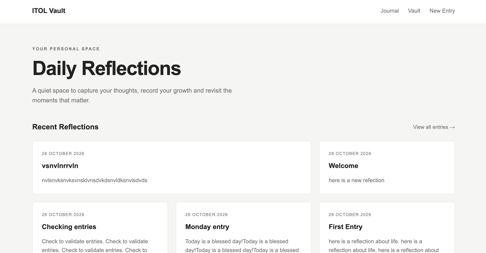

# ITOL Vault

A responsive digital journal for recording and revisiting personal reflections.

## Features

- Create journal entries with a title and reflection.
- Save entries in browser localStorage.
- Display the five most recent entries on the Home page.
- Display all saved entries in the Vault.
- Sort entries by date, newest first.
- Responsive layouts for desktop and mobile.
- Accessible navigation and labelled form fields.

## Technologies

- HTML5
- CSS3
- JavaScript
- Browser localStorage

## How the Five Most Recent Entries Work

JavaScript retrieves the saved entries from localStorage and sorts a copy of the array by date, with the newest entry first. The `slice(0, 5)` method then selects the first five entries for the Home page. The Vault uses the complete sorted array to display all saved entries.

## Data Persistence

Entries are stored in the browser using localStorage. They remain available after refreshing the page, provided the browser's stored data is not cleared and the same origin is used.

Documentation: [MDN — Window: localStorage](https://developer.mozilla.org/en-US/docs/Web/API/Window/localStorage)

## Screenshot

(screenshot/screenshot.png)

## Running the Project

Open `index.html` using a local development server such as VS Code Live Server.

## Project Status

Completed after final testing.
